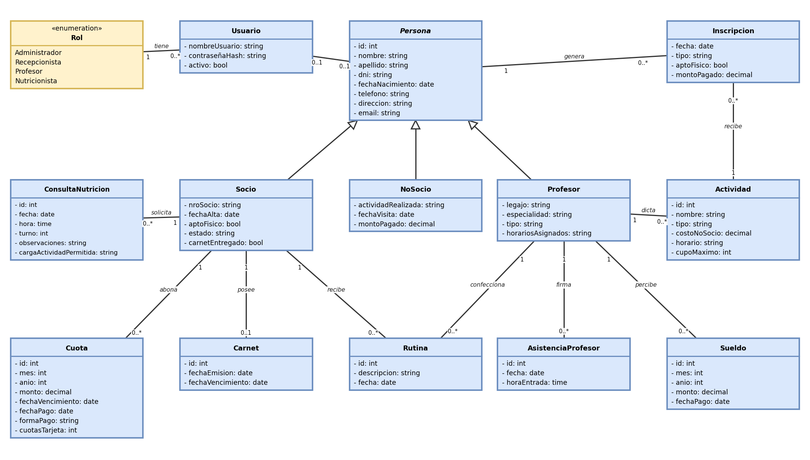
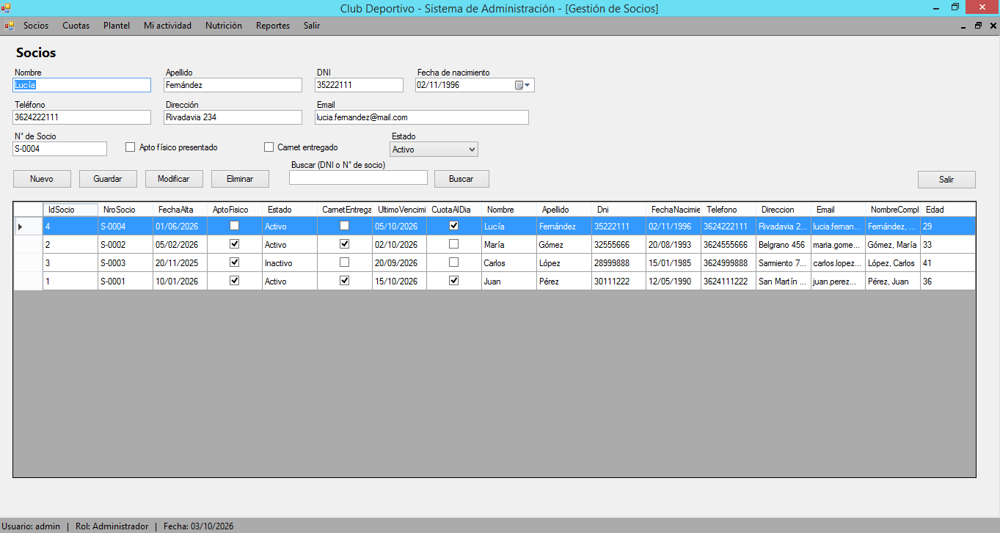

# 📝 Sistema de Club Deportivo — IFTS N° 29

Proyecto Integrador: análisis, diseño, desarrollo, prueba y puesta a punto de un sistema de escritorio para la gestión integral de un club deportivo.

**Tecnologías:** C# · Windows Forms (.NET 4.8) · MySQL  
**Arquitectura:** En capas — Presentación · Negocio · Datos · Entidades

---

## 📐 Diagrama de Clases (UML)

---

## 📷 Captura
 

---

## 🚀 Ejecución rápida

1. **Base de datos:** `mysql -u root -p < Database/proyecto_club.sql`
2. **Abrir** `ClubDeportivo.sln` en Visual Studio 2019+.
3. **Compilar** con F5 (restaura NuGet `MySql.Data` automáticamente).
4. **Ajustar** cadena de conexión en `App.config` si es necesario.

### Usuarios de prueba

| Usuario | Contraseña | Rol |
|---------|------------|-----|
| `admin` | `admin123` | Administrador |
| `recepcion` | `recepc123` | Recepcionista |
| `profesor1` | `prof123` | Profesor |
| `nutricionista1` | `nutri123` | Nutricionista |

---

## 📦 Release

Cambiar a **Release** → Compilar → ejecutable en `bin/Release/net48/ClubDeportivo.exe`

---

## 💻 Estado

14 casos de prueba ejecutados (CP01–CP14): todos coinciden con el resultado esperado.

**Mejoras futuras:** log de auditoría, recordatorios automáticos, recuperación de contraseña, pasarela de pago real.

---

**IFTS N° 29** — Proyecto Integrador